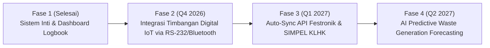

# **MONOWA**
### *Smart Waste & EHS Monitoring System*
Sistem Terintegrasi Pemantauan Limbah B3 & Domestik Berbasis Real-time

**Presenter**: Tim Pengembang & EHS Division  
**Tanggal**: Oktober 2026  
**Target Audiens**: Direksi, Manajemen EHS, Kepala Operasional & Tim Kepatuhan Regulasi

---

## **Daftar Isi Presentasi**

1. **Latar Belakang & Urgensi Bisnis**
2. **Tantangan Operasional Lapangan (Problem Statement)**
3. **Solusi: Memperkenalkan MONOWA**
4. **Fitur Unggulan Sistem**
   - *Pencatatan & Tracking Limbah B3*
   - *Sistem Peringatan Dini Masa Simpan (Early Warning System)*
   - *Pencatatan Limbah Domestik Berbasis Sesi (Pagi & Sore)*
   - *Dashboard Analytics & Monitoring Kapasitas TPS*
5. **Arsitektur Teknologi & Keamanan Data (RBAC)**
6. **Dampak Bisnis, Efisiensi & Kesiapan Audit**
7. **Rencana Pengembangan (Roadmap)**
8. **Demonstrasi Sistem & Tanya Jawab (Q&A)**

---

## **1. Latar Belakang & Regulasi**

### Kepatuhan Lingkungan Bukan Lagi Pilihan, Melainkan Kewajiban Hukum

- **Regulasi Nasional Ketat**:
  - UU No. 32 Tahun 2009 tentang Perlindungan dan Pengelolaan Lingkungan Hidup.
  - **PP No. 22 Tahun 2021**: Baku mutu masa simpan limbah B3 (90, 180, dan 365 hari).
- **Tuntutan Standar ESG & ISO**:
  - ISO 14001 (Sistem Manajemen Lingkungan).
  - Tuntutan transparansi jejak limbah (*Waste Traceability*) dari investor dan auditor.

> *Catatan Pembicara (Speaker Note)*:
> "Selamat pagi/siang Bapak/Ibu sekalian. Pengelolaan limbah industri kini bukan hanya sekadar operasional rutin kebersihan, melainkan pilar utama compliance perusahaan dengan sanksi administratif hingga pidana apabila terjadi kelalaian penyimpanan limbah B3 melebihi batas waktu."

---

## **2. Problem Statement: Titik Rawan Logbook Konvensional**

| Tantangan Konvensional | Risiko Nyata Perusahaan |
|---|---|
| **Pencatatan Kertas / Spreadsheet Tersebar** | Data tercecer, human error, sulit diverifikasi saat sidak audit |
| **Tidak Ada Peringatan Batas Simpan** | Limbah B3 mengendap di TPS melebihi batas legal tanpa disadari |
| **Pencatatan Domestik Tidak Terstruktur** | Komposisi organik vs anorganik tidak terpantau, target *zero waste* bias |
| **Bukti Fisik Timbangan Mudah Hilang** | Sengketa volume antara perusahaan dan pihak transporter berizin |

> *Catatan Pembicara (Speaker Note)*:
> "Sebelum adanya sistem ini, operator mencatat di buku tulis atau Excel manual. Ketika ada rotasi shift atau pergantian vendor transporter, tanggal kedaluwarsa limbah B3 sering kali luput dipantau. Monowa hadir untuk meniadakan seluruh celah risiko ini."

---

## **3. Solusi: MONOWA - Smart Waste System**

**MONOWA** adalah ekosistem digital terpadu yang menghubungkan operator timbangan TPS, manajemen EHS, dan auditor dalam satu platform terpadu.

- ⚡ **Real-Time Data**: Input data timbangan langsung tersinkronisasi ke dashboard pusat.
- 🚨 **Automated Alerting**: Peringatan otomatis H-30, H-7, dan Kedaluwarsa sebelum limbah melanggar batas izin.
- 📸 **Digital Evidence**: Verifikasi foto timbangan fisik dan nomor manifest langsung di cloud.
- 🛡️ **Audit-Ready**: Laporan logbook standar KLHK dapat di-generate kapan saja dalam hitungan detik.

---

## **4. Modul 1: Manajemen Limbah B3 Terintegrasi**

### Kendali Penuh dari Penyerahan Internal hingga Pengangkutan Pihak Ketiga

- **Pencatatan Masuk (B3 IN)**:
  - Kode limbah baku (B107d, B110d, dll.) & asal unit kerja.
  - Perhitungan otomatis tenggat waktu simpan sejak hari pertama masuk.
  - Dokumentasi jenis kemasan (Drum, IBC Tank, Jumbo Bag).
- **Pencatatan Keluar (B3 OUT)**:
  - Validasi legalitas transporter berizin KLHK.
  - Pencatatan nomor Festronik / Manifest pengangkutan & nomor polisi kendaraan.
  - Rekonsiliasi bobot otomatis untuk memastikan neraca limbah seimbang.

---

## **5. Modul 2: Early Warning System (Mesin Kepatuhan)**

```
┌─────────────────┐       ┌─────────────────┐       ┌─────────────────┐
│   🟢 AMAN       │  ──>  │  🟡 WASPADA     │  ──>  │  🟠 KRITIS      │
│  > 30 Hari      │       │  H-30 Hari      │       │  H-7 Hari       │
│  Penyimpanan    │       │  Notifikasi EHS │       │  Percepatan     │
│  Sesuai Izin    │       │  Vendor Booking │       │  Pengangkutan   │
└─────────────────┘       └─────────────────┘       └─────────────────┘
```

- **Pengecekan Otomatis (Cron Worker)**:
  - Sistem memeriksa seluruh lot limbah yang masih tersimpan di TPS setiap hari.
  - Notifikasi aktif di badge dashboard & panel alert sistem.
  - **Mencegah sanksi denda dan pembekuan izin operasional TPS B3**.

---

## **6. Modul 3: Manajemen Limbah Domestik Berbasis Sesi**

### Mendukung Kebijakan 3R & Target Pengurangan Sampah Fasilitas

- **Dua Sesi Penimbangan Harian**:
  - **Sesi Pagi (08:00 - 10:00)**: Pembersihan area pabrik & kantor shift malam.
  - **Sesi Sore (15:00 - 17:00)**: Pembersihan rutin aktivitas harian fasilitas.
- **Kategori Pemilahan Terstruktur**:
  - **Fraksi Organik**: Diprioritaskan untuk komposting & biodigester.
  - **Fraksi Anorganik**: Kertas, kardus, plastik bernilai ekonomis (Bank Sampah / Daur Ulang).
  - **Residu**: Minimalisasi volume yang dibuang ke Tempat Pemrosesan Akhir (TPA).

---

## **7. Modul 4: Dashboard Analytics & Kapasitas TPS**

### Visibilitas Eksekutif dalam Satu Layar Responsif

- **KPI Sparklines**:
  - Total akumulasi bobot masuk vs keluar periode berjalan.
  - Neraca sisa limbah aktif dalam gudang TPS.
- **Gauge Utilisasi TPS**:
  - Persentase keterisian ruang simpan TPS terhadap kapasitas izin lingkungan.
- **Grafik Tren Komparatif**:
  - Tren bulanan timbulan limbah per departemen penghasil.
  - Mengidentifikasi unit kerja dengan timbulan sampah tertinggi untuk program minimasi limbah.

---

## **8. Keunggulan Desain Antarmuka (Industrial UX)**

- **6 Tema Tampilan Visual**:
  - *Corporate* (standar rapat manajemen), *Frosted Glass*, *Liquid*, *Flat*, *High Contrast* (untuk operator di area terbuka berpanas terik), dan *Night City* (shift malam).
- **Dukungan Multi-Bahasa & Layout RTL**:
  - Mendukung Bahasa Indonesia (ID) dan Bahasa Arab (AR) secara instan.
- **Aksesibilitas Multi-Device**:
  - Dashboard lengkap untuk PC desktop di ruang kantor EHS.
  - Tampilan form ringkas dengan bottom bar untuk tablet/ponsel operator di lapangan.

---

## **9. Arsitektur Teknologi & Keamanan Data**

```
[ Frontend: React 19 + TypeScript + Vite 8 + Tailwind CSS v4 ]
                       │  (JSON REST API via Sanctum)
[ Backend: Laravel 11 Engine + Artisan Task Scheduler ]
                       │  (ORM & Transactions)
[ Database: MySQL 8.0 Enterprise / Cloud Database ]
```

- **Role-Based Access Control (RBAC)**:
  - `ADMIN_EHS`: Otoritas penuh, hapus data salah, konfigurasi ambang batas.
  - `OPERATOR_TPS`: Input penimbangan harian, foto timbangan, tanpa hak menghapus riwayat audit.
  - `AUDITOR`: Akses *view-only* untuk transparansi inspeksi tanpa risiko manipulasi data.
- **Integritas Audit Trail**: Pencatatan otomatis `created_by`, `updated_by`, dan *timestamp*.

---

## **10. Dampak Bisnis & Nilai Investasi (ROI)**

| Indikator | Sebelum MONOWA | Sesudah MONOWA | Dampak / Efisiensi |
|---|---|---|---|
| **Waktu Pembuatan Laporan** | 3 - 5 Hari Kerja | **< 10 Detik (1-Click)** | ⚡ Penghematan 95% Waktu Kerja |
| **Keterlambatan Masa Simpan B3** | Rawan terlewat | **0 Insiden (Zero Violation)** | 🛡️ Proteksi dari Sanksi KLHK |
| **Konsumsi Kertas Logbook** | Ratusan formulir/tahun | **100% Paperless Digital** | 🌱 Pengurangan Emisi Karbon |
| **Kesiapan Audit Eksternal** | Butuh rekonsiliasi manual | **Siap Kapan Saja (Audit-Ready)** | 🏆 Meningkatkan Reputasi ESG |

---

## **11. Roadmap Pengembangan Mendatang**



---

## **12. Skenario Live Demo (Panduan Presentasi)**

1. **Dashboard Overview**:
   - Menunjukkan status lampu peringatan aktif (H-30 / H-7) dan persentase kapasitas TPS.
2. **Pencatatan Limbah B3 Masuk**:
   - Simulasi penerimaan 2 drum oli bekas dari Workshop Maintenance lengkap dengan foto timbangan.
   - Menunjukkan perhitungan otomatis batas simpan 90 hari.
3. **Pencatatan Limbah Domestik Sesi Pagi**:
   - Input pemilahan organik vs anorganik kantin.
4. **Penggantian Tema & Ekspor Laporan**:
   - Menunjukkan transisi mode gelap & cetak laporan rekapitulasi limbah.

---

## **13. FAQ / Antisipasi Pertanyaan Penguji & Stakeholder**

### Q1: Bagaimana jika koneksi internet di area TPS terputus saat operator menimbang?
> **Jawaban**: Frontend Monowa memiliki arsitektur client-state dengan penanganan data lokal. Data tetap aman dan dapat di-submit kembali begitu koneksi internet pulih.

### Q2: Apakah data di sistem ini diakui secara legal oleh dinas lingkungan hidup?
> **Jawaban**: Ya. Format kolom pencatatan Monowa (Nama limbah, kode limbah, tanggal masuk, tanggal keluar, nomor manifest, transporter, neraca saldo) dirancang mengacu pada standar Lampiran IX PP No. 22 Tahun 2021.

### Q3: Bagaimana menjamin operator tidak mengubah data timbangan yang sudah lampau?
> **Jawaban**: Sistem menerapkan RBAC ketat. Hanya akun berwenang (*Admin EHS*) yang dapat menyetujui koreksi, dan setiap perubahan tercatat dalam sistem riwayat audit (*audit log*).

---

# **Terima Kasih**
## **Mari Wujudkan Pengelolaan Lingkungan yang Aman, Patuh, dan Terdigitalisasi.**

**MONOWA (Monitoring Limbah System)**  
*Smart • Compliant • Sustainable*

Pertanyaan & Diskusi Terbuka Silakan Diajukan.
