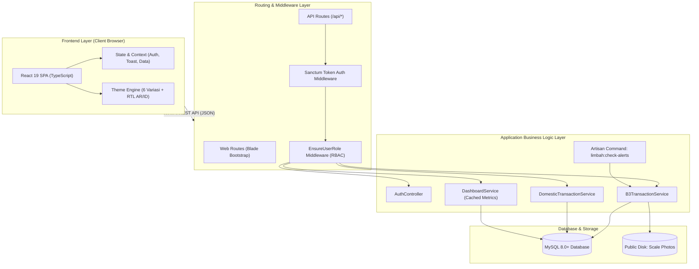
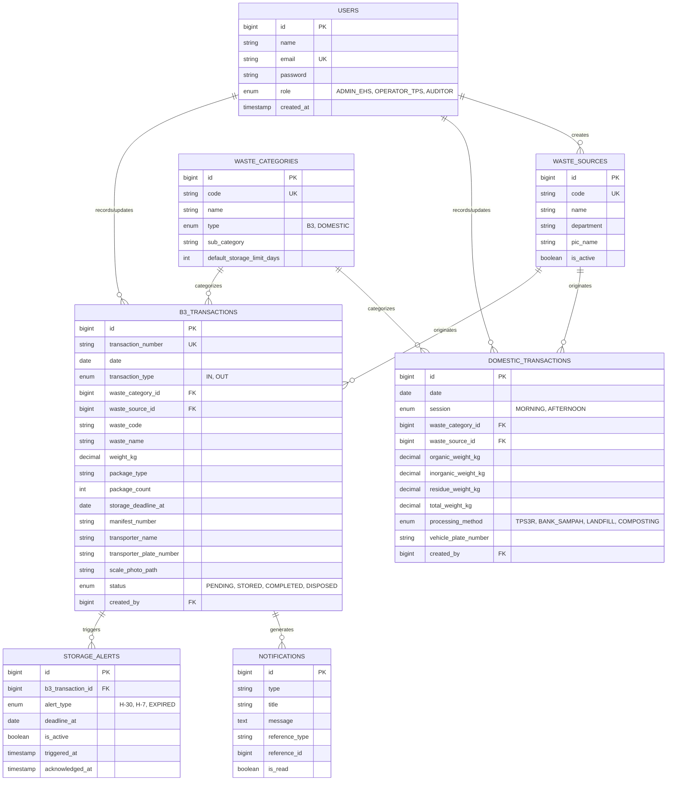

# Arsitektur Sistem - MONOWA (Monitoring Limbah & EHS System)

Dokumen ini mendokumentasikan arsitektur sistem, desain basis data, skema keamanan, serta mesin kepatuhan regulasi lingkungan pada aplikasi **Monowa**.

---

## 1. Ikhtisar Sistem (System Overview)

**Monowa** adalah sistem informasi manajemen dan monitoring limbah terpadu yang dirancang untuk mendukung departemen *Environment, Health, and Safety* (EHS) dan operator *Tempat Penyimpanan Sementara* (TPS) limbah. Sistem ini berfokus pada:
1. **Tata Kelola Limbah B3 (Bahan Berbahaya dan Beracun)** sesuai regulasi Kementerian Lingkungan Hidup dan Kehutanan (KLHK) / PP No. 22 Tahun 2021.
2. **Tata Kelola Limbah Domestik / Non-B3** dengan pencatatan berbasis sesi ritasi (pagi dan sore) serta pemilahan fraksi organik, anorganik, dan residu.
3. **Peringatan Dini Masa Simpan (Early Warning System)** untuk mencegah pelanggaran baku masa simpan limbah B3 (90, 180, dan 365 hari).
4. **Dashboard Eksekutif & Logbook Real-time** dengan visualisasi tren, utilisasi kapasitas TPS, dan transparansi data untuk kesiapan audit.

---

## 2. Arsitektur Komponen (High-Level Architecture)

Aplikasi dibangun menggunakan pola arsitektur **Decoupled Monolith (SPA with RESTful API)**:
- **Backend**: Laravel 11 bertindak sebagai penyedia API RESTful terpusat, pengelola otentikasi Sanctum, validasi bisnis, dan *scheduled task engine*.
- **Frontend**: React 19 + TypeScript yang dibundel menggunakan Vite 8 dan di-inject secara native ke dalam lifecycle Laravel Blade melalui `@viteReactRefresh`.
- **Database**: MySQL 8.0+ (atau SQLite pada lingkungan pengujian lokal).
- **Styling**: Tailwind CSS v4 dengan sistem token desain kustom multi-tema.

---

## 3. Entity Relationship Diagram (ERD)

Struktur relasi data dalam Monowa dirancang normal dan dilengkapi audit trail (`created_by`, `updated_by`):

---

## 4. Mesin Kepatuhan Masa Simpan (Compliance Engine)

Sesuai regulasi limbah berbahaya di Indonesia:
- **Kategori 1**: Batas penyimpanan maksimal **90 hari**.
- **Kategori 2 (Sumber Tidak Spesifik / Spesifik Umum)**: Batas simpan **180 hari** atau **365 hari** (apabila laju timbulan < 50 kg/hari).

### Logika Penghitungan Otomatis
1. Saat operator menginput limbah B3 Masuk (`transaction_type = IN`), sistem menghitung batas tenggat waktu:
   $$\text{storage\_deadline\_at} = \text{tanggal\_masuk} + \text{kategori.default\_storage\_limit\_days}$$
2. Perintah terjadwal (`CheckB3Alerts` / `php artisan limbah:check-alerts`) dieksekusi secara otomatis setiap hari pada jam 00:00:
   - **H-30**: Jika sisa hari $\le 30$ hari $\rightarrow$ Terbitkan peringatan status **Waspada**.
   - **H-7**: Jika sisa hari $\le 7$ hari $\rightarrow$ Terbitkan peringatan status **Kritis** (Segera jadwalkan pengangkutan pihak ke-3).
   - **EXPIRED**: Jika tanggal hari ini $>$ `storage_deadline_at` $\rightarrow$ Terbitkan peringatan status **Pelanggaran Regulasi**.

---

## 5. Matriks Keamanan & Akses (RBAC)

Sistem menggunakan middleware `EnsureUserRole` untuk mengisolasi fungsionalitas berdasarkan peran kerja:

| Modul / Kemampuan | Admin EHS | Operator TPS | Auditor (Pengawas) |
|---|:---:|:---:|:---:|
| Akses Dashboard & Logbook | ✅ Full | ✅ Full | ✅ Read-Only |
| Input Transaksi B3 (Masuk/Keluar) | ✅ Ya | ✅ Ya | ❌ Tidak |
| Input Transaksi Domestik | ✅ Ya | ✅ Ya | ❌ Tidak |
| Edit Transaksi Hari Berjalan | ✅ Ya | ✅ Ya | ❌ Tidak |
| Hapus Riwayat Transaksi | ✅ Ya (Otoritas Penuh) | ❌ Tidak | ❌ Tidak |
| Kelola Sumber Limbah (Waste Sources) | ✅ Ya | ✅ Ya | ❌ Read-Only |
| Konfigurasi Ambang Batas & Sistem | ✅ Ya | ❌ Tidak | ❌ Tidak |
| Acknowledge / Tutup Alert B3 | ✅ Ya | ✅ Ya | ❌ Tidak |
| Export Data (Excel, CSV, PDF Report) | ✅ Ya | ✅ Ya | ✅ Ya |

---

## 6. Desain Antarmuka Pengguna & Theme Engine

Frontend Monowa dirancang dengan filosofi **Industrial UX**:
- **Dukungan 6 Tema Tampilan**:
  1. *Corporate*: Tema standar korporat bernuansa clean slate/blue.
  2. *Frosted*: Glassmorphism modern dengan backdrop blur.
  3. *Liquid*: Nuansa fluida transisi dinamis.
  4. *Flat*: Desain minimalis tanpa ornamen berat untuk kecepatan render tinggi.
  5. *High Contrast*: Memenuhi standar aksesibilitas WCAG untuk kondisi pencahayaan terik di TPS.
  6. *Night City*: Tema gelap beraksen cyberpunk neon untuk monitoring shift malam.
- **Dukungan Multi-Bahasa**:
  - Bahasa Indonesia (ID) sebagai bahasa operasional utama.
  - Bahasa Arab (AR) dilengkapi transformasi tata letak **RTL (Right-to-Left)** otomatis.
- **Desain Adaptif Perangkat**:
  - Desktop: Sidebar penuh dengan logbook interaktif dan filter multi-kolom.
  - Tablet/Ponsel Lapangan: Navigasi bawah (*Mobile Bottom Bar*) dengan form penimbangan cepat yang ramah sentuhan.
